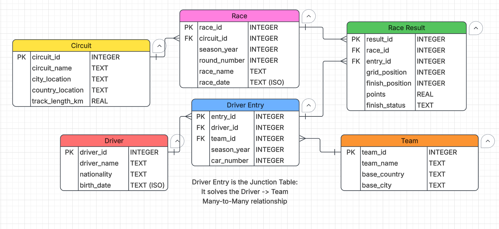

# F1 Race Results Tracker

A database-backed web application for the 2024 Formula 1 season. It stores teams, drivers, circuits,
races, and every race result in a relational database, and lets a user browse, search, add, correct,
and delete results and see standings and charts, all from a browser and without typing SQL.

## Project overview

**What it does.** The system keeps the 2024 season (24 races, 24 drivers, 10 teams, 479 results) in a
SQLite database. Championship standings are never stored: they are calculated from the race results,
so they cannot get out of sync with the data.

**Intended users.**
- *Fans and analysts* look up drivers and races, compare drivers, and follow the championship race by race.
- *Data maintainers* record new results, correct mistakes, and delete wrong entries.

**Major functionality.** Search and browse drivers; driver profiles and race result sheets (joins across
six tables); register a driver; record, correct, and delete a race result; driver and team standings;
a race-by-race standings chart for drivers and teams; a head-to-head driver comparison; and a
transaction demonstration page.

## DBMS

**SQLite 3.25 or newer.** The database is one local file (`f1.db`). No hosted service, server, account,
or password is used, so there are no credentials or secrets anywhere in this repository.
(Version 3.25 is needed for window functions, which the progress chart uses; the SQLite built into
Python 3.8 and newer is recent enough.)

## Repository contents

| File or folder | Purpose |
|---|---|
| `erd.png` | Final ER diagram |
| `schema.sql` | Creates all tables, constraints, indexes, and views |
| `insert_data.sql` | Loads the 2024 season sample data (588 rows) |
| `queries.sql` | The nine required queries, each labelled and commented |
| `transaction.sql` | A multi-step transaction demonstration (ends in `ROLLBACK`) |
| `run_queries.sh` | Rebuilds the database and runs the SQL files |
| `web_app.py` | Flask application: routes for each page and form, plus input-checking helpers |
| `db.py` | All database access (every SQL statement is here, parameterized) |
| `charts.py` | Draws the standings charts as SVG (no internet or JavaScript library needed) |
| `templates/`, `static/` | HTML pages and the stylesheet |
| `requirements.txt` | Python dependencies (Flask only) |
| `.gitignore`, `.gitattributes` | Keep `f1.db` out of Git and keep Unix line endings for `run_queries.sh` |

## ER diagram



Six tables. All relationships are one-to-many, with the "many" side holding the foreign key:

- `Team` 1 : many `Driver_Entry` (`team_id`)
- `Driver` 1 : many `Driver_Entry` (`driver_id`)
- `Circuit` 1 : many `Race` (`circuit_id`)
- `Race` 1 : many `Race_Result` (`race_id`)
- `Driver_Entry` 1 : many `Race_Result` (`entry_id`)

`Driver` and `Team` are **many-to-many** (a driver can race for many teams, a team uses many drivers).
The junction table `Driver_Entry` resolves it: one row is one driver racing for one team in one season,
and it holds the relationship's own data, `season_year` and `car_number`. In the diagram the tables are
named with spaces (Driver Entry, Race Result); in SQL they use underscores.

## Database setup

**Software:** the `sqlite3` command-line shell (and `bash` if you want to use `run_queries.sh`).

**Order:** run `schema.sql` first, then `insert_data.sql`, on a new empty database.

Option A, one command (rebuilds `f1.db`, runs the queries, runs the transaction demo):

```
bash run_queries.sh
```

Option B, by hand in the `sqlite3` shell:

```
sqlite3 f1.db
sqlite> .read schema.sql
sqlite> .read insert_data.sql
sqlite> PRAGMA foreign_key_check;     -- should print nothing
```

**Foreign keys:** SQLite only enforces foreign keys when `PRAGMA foreign_keys = ON;` is set, and the
setting is per connection. Each SQL file sets it, and the application sets it on every connection.

**Configuration values:** none. The application opens `f1.db` in the same folder as the code, so there
is no connection string, password, or `.env` file to supply.

Row counts after loading: Team 10, Driver 24, Circuit 26, Race 24, Driver_Entry 25, Race_Result 479
(588 rows in total).

**What the schema contains**
- *Constraints beyond keys:* `NOT NULL`; `UNIQUE (driver_id, team_id, season_year)` and
  `UNIQUE (season_year, car_number)` on `Driver_Entry`; `UNIQUE (season_year, round_number)` on `Race`;
  `UNIQUE (race_id, entry_id)` on `Race_Result`; `CHECK`s on points, grid position, track length,
  years, car numbers, and ISO dates; a `CHECK` that a finisher has a finishing position and the status
  `Finished` while every other status has none; and defaults for `points` and `finish_status`.
- *Views:* `v_driver_season_standings` (standings per driver and season, calculated from results) and
  `v_race_results_detail` (one readable row per result across all six tables).
- *Indexes:* `idx_race_result_entry` on `Race_Result(entry_id)` (the join used by season totals) and
  `idx_driver_name` on `Driver(driver_name)` (driver search).

## Application setup

The application is written in **Python** (3.8 or newer) with **Flask**.

1. Install the dependency:
   ```
   pip install -r requirements.txt
   ```
   (If `pip` is not found, use `python3 -m pip install -r requirements.txt`.)
2. Start the application:
   ```
   python3 web_app.py
   ```
3. Open **http://127.0.0.1:5000** in a browser. Press `Ctrl+C` in the terminal to stop it.

If `f1.db` does not exist, the application builds it automatically from `schema.sql` and
`insert_data.sql`. To restore the original data at any time, stop the app and run
`python3 web_app.py --reset`.

**Database connection:** `db.connect()` opens `f1.db` next to the code, turns on foreign keys, and the
connection is closed at the end of every request. The server listens only on 127.0.0.1 (this computer)
with debug mode off.

## Major application operations

| Operation | Where to find it | What happens in the database |
|---|---|---|
| Search or browse drivers | **Drivers** page | `SELECT` with `LIKE` and a parameter |
| Driver profile, race results | **Drivers**, then a name; **Races**, then a race | Joins `Driver`, `Driver_Entry`, `Team`, `Race`, `Circuit`, `Race_Result` |
| Register a driver | **Register driver** | `INSERT` into `Driver` and `Driver_Entry` in one transaction |
| Record a result | A race page, then **Record a result** | `INSERT` into `Race_Result` (points calculated from the finishing position) |
| Correct or delete a result | A race page, then **Correct** or **Delete** | `UPDATE` (points recalculated) or `DELETE` after a confirmation page |
| Standings | **Standings** page | Driver table from the view; team table from a join with `GROUP BY` |
| Progress chart | **Progress chart** page (Drivers and Teams tabs) | Window function (`ROW_NUMBER() OVER`) over running point totals |
| Head-to-head comparison | **Compare** page | Self-join on `Race_Result` with a `CASE` expression |
| Transaction demo | **Transaction demo** page | Runs the `transaction.sql` scenario with explicit `BEGIN` / `COMMIT` / `ROLLBACK`; choose *roll back*, *commit*, or *failing step 3* (a foreign-key error that undoes steps 1 and 2) |

**Safety and errors.** Every user-supplied value reaches SQL through `?` placeholders, never string
concatenation. Forms validate input (required text, number ranges, ISO dates, list choices, duplicate
car numbers, duplicate drivers, duplicate finishing positions, and a driver cannot get two results in
one race). Constraint and foreign-key errors become short messages, missing records show a "not found"
page, and no stack traces are shown.

## About the data

The data is the full 2024 season from the public dataset `Formula1_2024season_raceResults.csv`
(github.com/toUpperCase78/formula1-datasets).
- **Race results only.** Sprint races are not included, so season totals are lower than the official
  championship totals (for example, Verstappen has 399 points). Points are as given in the dataset and
  include the 2024 fastest-lap bonus point.
- **Finishing status.** A numeric position is stored as `Finished` (a classified finisher, even if the
  driver retired late). Drivers who did not finish have no finishing position and a status of
  `DNF - Retired`, `DNS - Did not start`, or `Disqualified`.
- **Mid-season team change.** Oliver Bearman raced for Ferrari (1 race) and Haas (2 races), so he has
  two `Driver_Entry` rows in 2024.
- Two real circuits that hosted no 2024 race (Circuit Paul Ricard and Istanbul Park) are included as
  reference rows, which gives the `LEFT JOIN` query unmatched rows.

## Schema changes from the earlier sample-data version

- No table or column changed, so the ER diagram is the same.
- `Driver_Entry` uniqueness changed from `(driver_id, season_year)` to `(driver_id, team_id, season_year)`
  so a mid-season team change can be stored.
- `v_driver_season_standings` now groups by driver and season instead of by entry.
- The sample data is the full 2024 season. `queries.sql` and `transaction.sql` were rewritten to match it
  (for example, the set-operation query now finds drivers with a podium finish but no win).

## Known limitations

- **Single season.** The data covers 2024 only.
- **Results only.** Sprint races, qualifying, lap times, and fastest laps are not stored.
- **Points on edited or new results.** The app calculates points from the standard 25-18-15-12-10-8-6-4-2-1
  scale. It does not add a fastest-lap point, so correcting an imported result that had one (for example
  26 points) recalculates it without that point.
- **No pages to add races, circuits, or teams,** and no page to give an existing driver a second team entry.
  Those changes need SQL. "Register driver" always creates a new driver with one entry.
- **No user accounts.** It is a single-user local application, run with Flask's development server, and
  is not intended to be exposed on a network.
- **One database rule lives in the application only.** The database does not stop a driver who has two
  entries (such as Bearman) from receiving two results in the same race; the application prevents it.
- **Transaction demo, commit mode.** It permanently adds a stand-in driver ("Jamie Okafor", a made-up
  person) until you click *Remove demo data*.

## Example quick test

1. **Drivers**: search `bear` and open Oliver Bearman. He has two teams in 2024 (Ferrari and Haas).
2. **Races**: open the Belgian Grand Prix. Hamilton won, and Russell was disqualified.
3. **Register driver**: 2024, Williams, car number 98. Then open the Australian GP, **Record a result**
   for the new driver, **Correct** it, and **Delete** it.
4. **Standings**: view the 2024 driver and team tables.
5. **Progress chart**: hover over a line to highlight a driver, then open the **Teams** tab.
6. **Compare**: Max Verstappen and Lando Norris.
7. **Register driver**: try car number 1 for 2024 to see the validation message.
8. **Transaction demo**: run *Run and roll back*, then *Run with a failing step 3*; the counts show
   nothing was kept. *Run and commit* keeps the rows until you click *Remove demo data*.

## Security

No passwords, API secrets, private keys, or connection strings are used or stored. The database is a
local file that is rebuilt from `schema.sql` and `insert_data.sql` and is excluded from Git.
